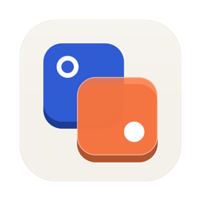

<div align="center">

<h1>
  
  &nbsp;xkeys
</h1>

**Remap keys at the driver level on macOS, and keep them remapped.**

One key becomes another below every program on the machine. External keyboards keep working where `CGEventTap` has gone blind. A held key turns into a modifier chord any app can bind. Per keyboard, if you want.


[](Package.swift)
[](Package.swift)
[](Checks/main.swift)
[](flake.nix)
[](LICENSE)

</div>

```console
$ xkeys doctor

  process           running (pid 9085)
  signature         xkeys-codesign
  Accessibility     granted
  Input Monitoring  granted (keyboard manager opened)
  config            ~/.config/xkeys/config.json - 3 swaps, 2 chords
  keyboards         Apple Internal Keyboard / Trackpad
                    gk61 pro 48
  swaps live        3 of 3 declared
  chords            LeftCommand held  ->  Cmd+Ctrl+Opt+Shift on the next key   on Apple Internal
                    LeftControl held  ->  Cmd+Ctrl+Opt+Shift on the next key   on gk61

  no problems found
```

## What it does

**Keeps your key swaps applied.** macOS can already remap keys in the HID driver, below every program on the machine. It just forgets them at reboot and resets them whenever a keyboard connects. xkeys re-asks.

**Keeps external keyboards working.** On macOS 26 and later, a `CGEventTap` receives nothing at all from external keyboards. Every window manager, launcher and global shortcut goes blind to them. xkeys reads those keyboards directly and replays their keystrokes, so the rest of your tools work again.

**Turns a held key into a real modifier chord.** Hold one key, press another, and the app you are in receives `Cmd+Ctrl+Opt+Shift+<key>`. That is a shortcut Raycast, Alfred or System Settings can actually record.

**Does it per keyboard.** Left Command on the laptop, Left Control on your 60% board, same chord out the other end.

## Install

```sh
git clone https://github.com/Xieyt/xkeys.git
cd xkeys

just setup-signing-cert   # once, see below
just install              # build, sign, install to /Applications, launch
```

Then write `~/.config/xkeys/config.json` and run `just restart`.

> [!IMPORTANT]
> **Do not skip the signing step.** macOS attaches permission grants to a
> signature. An ad-hoc signature changes on every build, so every rebuild looks
> like a brand new app and asks for Accessibility and Input Monitoring again.
> `just setup-signing-cert` creates one stable self-signed identity and the
> grants then survive rebuilds. Use your own with
> `just signing_cert=my-identity install`.

### Nix

The flake ships a dev shell and two modules. It ships no package: nixpkgs has Swift 5.10 on darwin and xkeys needs Swift 6, so nothing in nixpkgs can compile it. Install the app itself once with `just install`; the modules own everything that repeats.

```nix
{
  inputs.xkeys.url = "github:Xieyt/xkeys";

  # nix-darwin: creates one stable signing identity, so the Accessibility and
  # Input Monitoring grants survive every rebuild.
  darwinModules = [ xkeys.darwinModules.xkeys ];

  # home-manager: owns ~/.config/xkeys/config.json and the launch agent.
  homeModules = [ xkeys.homeManagerModules.xkeys ];
}
```

```nix
programs.xkeys = {
  enable = true;
  swaps = [
    { from = "CapsLock"; to = "Escape"; }
    { from = "LeftCommand"; to = "F20"; on = "Apple Internal"; }
    { from = "LeftControl"; to = "F20"; on = "gk61"; }
  ];
  chords = [
    { when = "LeftCommand"; on = "Apple Internal"; hold = [ "Command" "Control" "Option" "Shift" ]; }
    { when = "LeftControl"; on = "gk61";           hold = [ "Command" "Control" "Option" "Shift" ]; }
  ];
};

services.xkeys.signingIdentity = "xkeys-codesign";  # default
```

Key and modifier names are checked while nix evaluates, against the real vocabulary extracted from the source, so a typo fails `darwin-rebuild` instead of quietly disabling one swap. So does swapping the same key twice in the same scope.

`nix develop` gives you `just` and, more usefully, a shell with `SDKROOT` and `DEVELOPER_DIR` cleared. A darwin dev shell normally points those at nixpkgs' Apple SDK, which the system Swift 6 compiler rejects outright.

## Configure

`~/.config/xkeys/config.json`:

```json
{
  "swaps": [
    { "from": "CapsLock",    "to": "Escape" },
    { "from": "LeftCommand", "to": "F20" }
  ],
  "chords": [
    {
      "when": "LeftCommand",
      "hold": ["Command", "Control", "Option", "Shift"],
      "hide": true
    }
  ]
}
```

| field | meaning |
|---|---|
| `swaps[].from` / `.to` | Any key name from `xkeys keys`. One key in, one key out. |
| `chords[].when` | The key your finger presses. Not what the swap turns it into. |
| `chords[].hold` | `command`, `control`, `option`, `shift`, `function`. |
| `chords[].hide` | Swallow the trigger so a bare tap types nothing. Default on. |
| `on` | Optional, on any swap or chord. Limits it to one keyboard. |

Run `xkeys check <file>` to validate a config before it goes live. It exits non-zero with the problem list, so a config generator can gate on it.

### Per keyboard

`on` takes a case-insensitive piece of the keyboard's name, so `"gk61"` matches `"gk61 pro 48"`. `xkeys keys` lists the attached keyboards to copy a name from.

```json
{
  "swaps": [
    { "from": "CapsLock",    "to": "Escape" },
    { "from": "LeftCommand", "to": "F20", "on": "Apple Internal" },
    { "from": "LeftControl", "to": "F20", "on": "gk61" }
  ],
  "chords": [
    { "when": "LeftCommand", "on": "Apple Internal", "hold": ["Command","Control","Option","Shift"] },
    { "when": "LeftControl", "on": "gk61",           "hold": ["Command","Control","Option","Shift"] }
  ]
}
```

A rule with no `on` applies everywhere. CapsLock stays Escape on both keyboards above.

## Why swap to a key that does not exist

A window manager wants a modifier nothing else can steal. Swap a key to one no keyboard physically has, and nothing in macOS or any app can collide with it, because no hardware can send it.

`xkeys keys` lists the safe targets:

```console
Safe swap targets - no Apple keyboard has ever had these keys
  Function        F20 F21 F22 F23 F24   F13-F19 exist on full-size Apple keyboards
  Editing         Again Undo Cut Copy Paste Find   HID editing keys, never on Apple hardware
  System          Execute Menu Select Stop
  Japanese/Korean Lang3 Lang4 Lang5 Lang6 Lang7 Lang8 Lang9   Lang1/Lang2 ship on JIS keyboards
  International   Intl4 Intl5 Intl6 Intl7 Intl8 Intl9   Intl1-Intl3 ship on JIS/ABNT keyboards
```

This is a fixed table, not a hardware query, and deliberately so. A MacBook's keyboard descriptor claims all 228 HID usages, including F13 through F20 and the Japanese language keys it physically does not have. The device cannot tell you what it is able to press. "Apple never shipped this key" is the only honest test.

## Commands

| command | what it does |
|---|---|
| `xkeys` | Run as a menu bar agent. |
| `xkeys doctor` | Check everything that decides whether this is working. |
| `xkeys keys` | Your swaps, chords, attached keyboards, and safe targets. |
| `xkeys watch` | Name each key as you press it, and what the system received. |
| `xkeys check <file>` | Validate a config without applying it. |
| `xkeys --uninstall` | Remove this app's swaps, leaving other tools' alone. |

`xkeys watch` saves you looking key names up:

```console
$ xkeys watch
watching the keyboard - press keys, ctrl-c to stop
swap: CapsLock -> Escape
swap: LeftCommand -> F20

  CapsLock      arrives as Escape      usage 0x29
  9                                    usage 0x26   chord: Cmd+Ctrl+Opt+Shift
  a                                    usage 0x04
```

## Permissions

| grant | needed for | without it |
|---|---|---|
| none | applying swaps | swaps still work |
| Accessibility | chords, and `xkeys watch` | swaps unaffected, chords silently inactive |
| Input Monitoring | seeing external keyboards | external keyboards invisible to other apps |

> [!NOTE]
> Swaps are applied *before* either permission is checked, so a revoked grant or
> an unanswered dialog never costs you your Escape key.

`just open-permissions` opens both panes. `just reset-permissions` clears the grants, needed only after changing the signing identity.

## Troubleshooting

Start with `xkeys doctor`. It names what each failure costs and how to fix it.

| symptom | cause |
|---|---|
| No menu bar icon, process running | Launch from Finder. A terminal-spawned launch can stall before the icon is created. |
| Chord fires in no app | Accessibility is missing. `xkeys doctor` says so. |
| Chord stopped working mid-session | The tap re-enables itself after a system timeout. If not, `just restart`. |
| Keys doubled on an external keyboard | Two tools are replaying the same device. |
| A swap is live you never declared | Another tool writes the same driver list. `xkeys keys` marks those `(not in your config)`. |

```sh
just debug-on && just restart && just log   # verbose log at /tmp/xkeys.log
just status                                 # pid, signature, swaps, chords, grants
just test                                   # 113 pure-logic checks
```

## How it works

<details>
<summary>Three layers, lowest to highest</summary>

**1. The HID driver.** `hidutil` owns one machine-wide swap list. xkeys reads it, changes only the entries it declared, and writes it back, so swaps belonging to other tools are never erased. `hidutil` also takes a device filter, which is how `on` targets one keyboard.

**2. The HID device.** External keyboards are seized over IOKit and replayed as ordinary events, because a `CGEventTap` cannot see them on macOS 26 and later. This layer sits below the driver swap, so it reports the key your finger pressed rather than what the swap turns it into.

**3. A session event tap.** This is where chord modifiers are painted on. It runs after a window manager has taken the keystrokes it binds, so the window manager keeps first pick and nothing fires twice.

Trigger state comes from layer 2, not from the event stream, because a window manager listening earlier may delete the trigger's own keypress before any tap sees it. That is also why `when` names the physical key: it is the only one the device reports.

</details>

<details>
<summary>Known limits</summary>

- **`hide` cannot be scoped to one keyboard.** By the time a keystroke reaches the tap it carries a key and no device. A trigger hidden on one keyboard is hidden on all, which is the desired behaviour anyway.
- **`Fn` cannot be a trigger.** Most keyboards resolve their `Fn` layer in firmware and never transmit the key, so nothing on the Mac can see it.
- **Changing a chord needs a restart.** Reload Config re-arms chords; changing the app's own permissions or signature does not.

</details>

## Not doing

No layers. No per-app rules. No tap-versus-hold. No key sequences.

Flat swaps and chords, scoped by keyboard, and nothing else. If you need the rest, you need [Karabiner-Elements](https://karabiner-elements.pqrs.org).

## Requirements

macOS 13 or later. A Swift 6 toolchain and [`just`](https://github.com/casey/just) to build. No third-party dependencies.

## Credits

Inspired by [hyperkey](https://github.com/feedthejim/hyperkey) by Jimmy Lai.
